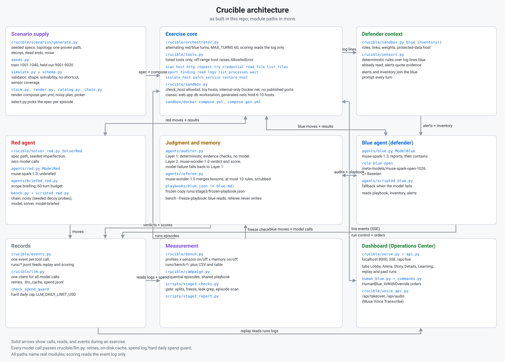
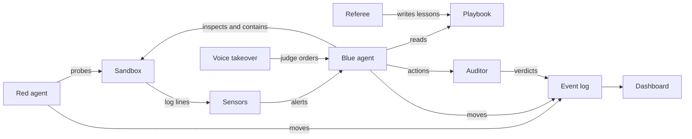

# Crucible

Somewhere right now, an AI agent is being trusted with a company's systems, and nobody can say how good its judgment really is. You can't test it on the real thing, because a wrong call there costs uptime, money, or customer data. Crucible is where you find out first.

Two AI teams play out a containment exercise on a simulated company network. One probes for a way in. The other watches the logs and decides what to shut down. A third, independent model audits every defensive decision against the exact evidence the defender had in front of it. Every move is logged, so any exercise can be replayed, scored, and argued with.

This is Crucible. A crucible is a trial that shows what something is really made of, and that is what this gives AI defenders.

I built it alone during the Meta Global AI Developer Hackathon, with Muse Code and Meta's Muse models.

The first results were wrong. A bug in my own test setup made the defender look smarter than it was. I caught it, threw out the whole campaign, and ran everything again. That habit of measuring, doubting, and measuring again is the point of this project.

With sensor alerts turned on, the defender contained 10 of 10 intrusions in our controlled runs and never lost the secret. With them off, the secret was read in 19 of 20. Below is exactly how we measured that, and what it does not prove.



Red probes, blue defends, and the auditor judges every defensive decision, all inside an internal-only Docker network.

## Headline results

- With sensor alerts on, Spark blue contained all 20 scripted intrusions and never lost the secret; with them off, the secret was read in 19 of 20 (chain p < 0.0001, noisy p = 0.0001, Fisher exact, computed). Limit: scripted red intrudes every episode by construction, one scenario, 10 episodes per cell.
- Against model red at 10 episodes per arm, the sensors gap was within noise (secret reads 0/10 versus 4/10, p = 0.087). Limit: small sample against a stochastic intruder, so this run concludes nothing about sensors there.
- Frozen-playbook memory on 20 held-out networks against solver red: with working sensors both memory arms contained 20 of 20 intrusions with 0 of 20 secret reads (ceiling effect, memory not distinguishable, B vs C p = 1.0); with sensors off, memory cut secret reads to 7 of 20 from 18 of 20 (paired exact p = 0.0010). Limit: solver red follows a known path, the briefed model red run covers 20 networks and is descriptive only, and the first sensors-on run is void because sensors were silently broken on generated networks (found by our own gate, fixed in two commits, reran).
- Spark and Spark Open blue each held all 20 scripted episodes with sensors on, though Open reported later (median first report 15 to 17 events versus 1 to 3). Limit: descriptive only at n = 10, with unmatched noisy-red draws across the two runs.

Details, intervals, and limits: `docs/SENSOR_RESULTS.md`, `docs/CAMPAIGN_RESULTS.md`, and `docs/STAGE3_RESULTS.md`.

## Architecture

- Sandbox of toy hosts on an internal-only Docker network, no published ports.
- One allowlisted action surface (`crucible/tools.py`): agents can only call listed tools against listed hosts.
- Red and blue agents (scripted baselines plus model versions), taking alternating turns through the orchestrator.
- Sensors and asset inventory: blue sees host roles, links, business weights, and deterministic sensor alerts.
- Auditor: a separate model call judges each blue action against the exact log lines blue had seen.
- Referee and playbook: after each exercise the referee merges lessons into a short tactical playbook (scrubbed of credentials, paths, and host names) that blue reads next run.
- Scenario generator: deterministic seeded networks with a proven intrusion path, decoys, dead ends, and noise, split into train and held-out seeds.
- Dashboard: the operations center page with live exercise views, replay, lobby, and results.
- Voice takeover: a judge can type or speak orders that blue executes live, through a command parser plus Muse Voice Transcribe.



## Models used and where

| Where | Model |
|---|---|
| Red team, blue team (main) | Muse Spark (`muse-spark-1.3`) |
| Blue team, open-weights variant | Muse Spark Open (`meta-models/muse-spark-open-1026`) on Baseten |
| Auditor and referee | Muse Wonder (`muse-wonder-1.0`) |
| Voice takeover transcription | Muse Voice Transcribe (`muse-voice-transcribe-1.0`) |
| Dashboard art | Muse Image (`muse-image-1.0`, generated at build time; [provenance](dashboard/assets/art/PROVENANCE.md)) |
| Dev and bulk runs | Muse Spark contributor (`muse-spark-1.3-contributor`) |

Chat models run through the Meta Model API (`https://api.meta.ai/v1`, OpenAI compatible); the open-weights blue variant runs on Baseten under a separate key. Every model call passes one client wrapper with retries, a disk cache, per-exercise spend logging, and a hard daily spend guard.

## Quickstart (fresh clone)

Prerequisites: Python 3.12 or newer, Docker running, a terminal.

```bash
git clone https://github.com/Lucaszy1/Crucible.git
cd Crucible
python3 -m venv .venv
source .venv/bin/activate
pip install -r requirements.txt
cp .env.example .env
```

Edit `.env`: set `MODEL_API_KEY` (required). Set `BASETEN_API_KEY` only for the open-weights blue variant. `LLM_DAILY_LIMIT_USD` caps estimated model spend per day.

Start the operations center (localhost only, no build step):

```bash
python -m crucible.serve
```

The server binds to localhost only, port 8000 by default (`python -m crucible.serve --port 8123` picks another). Open http://127.0.0.1:8000 in a browser. Use the control bar to run a scripted exercise, run a metered model exercise, or replay a past run.

Run one scripted exercise from the terminal (free, needs Docker):

```bash
python -m crucible.run_exercise --agents scripted --exercise-id demo-1
```

Run a small benchmark (scripted red costs nothing; blue model calls are metered):

```bash
python -m crucible.bench --name try --red chain --sensors on --memory off --episodes-per-cell 2
```

Run the checks without spending anything:

```bash
python -m pytest tests -m "not live" -q
node --test tests/*.mjs
```

Live-marked tests need the range up and can spend money; the `-m "not live"` filter stays on for routine runs.

## Repo layout

```text
crucible/          turn loop, agents, tools, API, scenarios, voice
crucible/agents/   red, blue, auditor, referee, scripted baselines
crucible/scenarios/ generator, simulator, seed sets, Docker stack files
dashboard/         static operations center page (HTML/JS, no build step)
docs/              specs, design notes, runbooks, result analyses
sandbox/           toy host images, compose files, classic scenario
scripts/           probes, art generation, Stage 3 merge and check tools
tests/             Python and node suites plus fixtures
runs/              exercise logs (local only, gitignored except a sample)
playbooks/         live blue playbook (local only, gitignored)
```

`docs/README.md` indexes the design notes and analyses.

## Results

All numbers below come from `docs/CAMPAIGN_RESULTS.md` (20 episodes per arm, classic scenario) and the saved benchmark runs under `runs/bench-*/`. Counts are quoted exactly; p-values marked computed were derived from those counts with exact tests (Fisher for unpaired cells, McNemar for paired Stage 3 seeds).

Validation story first. Our first campaign looked like a win for memory, then analysis showed the result was contaminated: container logs were never cleared between episodes, so blue read stale success lines, quoted them in reports, and red (which could then see blue report text) reused the leaked account names. We threw that campaign out, fixed the design (per-episode log scoping with clean-start checks, and prompts where neither team sees the other team's report text), and reran from scratch. The rerun is the only campaign we report.

Memory versus control (model red and model blue, one scenario, 20 episodes per arm): the memory arm held 16 of 20, control held 10 of 20 (Fisher exact two-sided p = 0.096, not significant at 0.05). Mean blue score was 79.9 versus 49.9 on a bimodal 0-or-100 scale, so the mean restates the win counts. Red probed the exposed admin page in 4 of 20 memory episodes versus 10 of 20 control, and that probe predicted the outcome perfectly; red is blind to blue by construction, so that gap is sampling variation, not something blue caused. That non-finding is specific to its setting (model red, online playbook, one scenario): the gap is within noise, every perfect score came with zero containment against a red that never authenticated, and blue contained 0 of its 4 real intrusions. The frozen-playbook held-out test below is the stronger memory evidence, and it goes the other way.

Sensors with scripted red (`runs/bench-bench1`, classic scenario, Spark blue, memory off, 10 episodes per cell):

| Red | Sensors | Intrusions | Secret reads | Contained |
|---|---|---|---|---|
| chain | on | 10/10 | 0/10 | 10/10 |
| chain | off | 10/10 | 10/10 | 6/10 |
| noisy | on | 10/10 | 0/10 | 10/10 |
| noisy | off | 10/10 | 9/10 | 3/10 |

Secret-read gap, sensors on versus off: chain p < 0.0001, noisy p = 0.0001 (Fisher exact two-sided, computed). Limits, stated plainly: scripted red intrudes in every episode by construction, so this measures containment of a fixed chain, not detection of a varied intruder; one scenario only; 10 episodes per cell.

Stage 3 held-out results (frozen 8-rule playbook from solver train seeds 1001 to 1009, held-out seeds 9001 to 9020, solver red, Open blue on Baseten, 1 episode per network per cell, 20 paired seeds, audit on the two sensors-on cells; sensors-on arms from the rerun `runs/bench-stage3-heldout-sensors`, sensors-off arms from the valid half of `runs/bench-stage3-heldout`):

| Blue | Memory | Intrusions | Secret reads | Contained |
|---|---|---|---|---|
| sensors off | off | 20/20 | 18/20 | 4/20 |
| sensors off | on | 20/20 | 7/20 | 14/20 |
| sensors on (rerun) | off | 20/20 | 0/20 | 20/20 |
| sensors on (rerun) | on | 20/20 | 0/20 | 20/20 |

Secret-read Wilson 95 percent: 18/20 (69.9, 97.2), 7/20 (18.1, 56.7), 0/20 (0.0, 16.1), 0/20 (0.0, 16.1). Paired exact (McNemar) two-sided per network: with working sensors the memory comparison is all ties on outcomes (B vs C secret reads 0-0 discordant, p = 1.0; containment 20/20 in both arms), a ceiling effect, so memory is not distinguishable with working sensors; detection delay leans faster with memory (11-4, p = 0.12) and downtime ties (4-4, p = 1.0), both within noise. The corrected sensors comparison pairs across benches by scenario (approximate, because red re-rolled between benches): secret reads 18-0 discordant (p < 0.0001), containment 0-16 (p < 0.0001), downtime 0-20 (p < 0.0001, the cost of containing), detection delay 2-0 (p = 0.50, only 2 paired reports). With sensors off, memory still helps on the valid within-run pairing: secret reads 11-0 (p = 0.0010), containment 0-10 (p = 0.0020).

The first run's sensors-on half is void: sensors were silently broken on generated networks (the reader polled the classic host list while generated networks use spec hosts, so every lookup missed), our own gate caught the zero-alert pattern, and two commits fixed it (bb567af for generated-net sensors plus the silent-bench failure, 1224db4 for collecting alerts on every blue turn plus the owed-silence check) before the rerun. The void arms read 17 of 20 secret reads without memory and 11 of 20 with memory (B vs C 6-0, p = 0.031), shown in `docs/STAGE3_RESULTS.md` for the record, not as evidence. `bench-stage3-train-solver` is void by the same bug.

Reference rows: noisy red with working sensors, 20 of 20 contained and 0 of 20 secret reads in both memory arms; Spark blue cross-check on 3 networks, 6 of 6 contained and 0 of 6 secret reads with median first report 3 events; briefed model red against Open blue on 20 held-out networks (descriptive only at n = 20): 18 of 20 networks had an intrusion, and all 18 were contained; red did not get a foothold on the other 2. Secret reads 0 of 18, median relevant detection delay 7 events and median time to contain 22 events, mean downtime 6.96%, cost $13.16, Baseten tokens 1,547,043. 1 of 600 red turns and 11 of 600 blue turns used a safe baseline move after model replies with no usable tool call, across 9 of 20 episodes.

Limits, stated plainly: solver red replays a known path with seeded noise, so this proves blue contains a known-path intruder on unseen networks, not that it stops an adaptive attacker; the briefed model red run covers 20 networks and is descriptive only, so it describes one sample; with working sensors every intrusion was contained in both memory arms, a ceiling effect, so memory is not distinguishable there; the sensors comparison pairs across benches because the rerun re-rolled red, so it is approximate; 20 networks are one pilot, not coverage; the playbook was learned against the solver's path distribution, where list-before-read always holds, and on train episodes whose sensors were void too, so its rules were learned without sensor input. Audit covered the rerun B and C cells only (justified 249 of 400 without memory, 230 of 400 with memory). Baseten tokens for the rerun, timestamp-attributed because the rerun reused episode ids: 800 calls, 1.90M in / 187k out / 114k reasoning; the void first run used 889 calls, 2.06M in / 162k out / 82k reasoning; check the invoice for dollars. Meta spend was $12.86 on the rerun (auditor calls) and $13.16 on the 20-network briefed run ($3.84 red, $9.31 auditor). 14 auditor verdicts in the corrected held-out rerun were replayed from the voided original run on byte-identical prompts; no blue, red, or referee response was cached and outcomes are unaffected.

## Open-weights blue

The same blue agent can run on Muse Spark Open (`meta-models/muse-spark-open-1026`) hosted on Baseten instead of Muse Spark on Meta. Red, the auditor, and the referee stay on Meta; only blue's calls move. Set `BASETEN_API_KEY` in `.env` and pass the blue flags:

```bash
python -m crucible.bench --name open-repro --red chain,noisy --sensors on --memory off --episodes-per-cell 10 \
  --blue-model meta-models/muse-spark-open-1026 --blue-base-url https://inference.baseten.co/v1 \
  --blue-api-key-env BASETEN_API_KEY --no-cache
```

Drop the `--blue-*` flags to run the Spark counterpart. Baseten spend shows as $0.00 in our logs by design (token counts only); check the Baseten invoice for real dollars. Full quirks and flag notes: `docs/BASETEN_NOTES.md`.

Spark versus Spark Open (`runs/bench-v2-spark`, `runs/bench-v2-open`; scripted red, sensors on, memory off, audit off, 10 episodes per cell):

| Blue | Red | Intrusions | Secret reads | Contained | Med first report | Meta cost |
|---|---|---|---|---|---|---|
| Spark | chain | 10 | 0 | 10 | 1 | $1.4558 |
| Spark | noisy | 10 | 0 | 10 | 3 | $1.4032 |
| Open | chain | 10 | 0 | 10 | 15 | $0.0000 |
| Open | noisy | 10 | 0 | 10 | 17 | $0.0000 |

Both held every episode. Open reported later but contained at the same median turn; descriptive only, see `docs/SENSOR_RESULTS.md`.

## Human takeover

A judge can take the defender seat live, by typing or by voice. Typed orders go to `POST /api/command`; spoken orders go to `POST /api/audio` as raw WAV bytes, transcribed by Muse Voice Transcribe and queued the same way (`docs/VOICE_API.md`).

Every order runs through the same gate: `crucible/commands.py` parses it onto the blue tool surface only (isolate, patch, restore, read logs, report finding, status, scan, stand down), and every path, deterministic parser, model fallback, or previewed action, passes through `validate_action` against the live allowlist and inventory. Ambiguous orders ask a clarifying question and never guess; anything outside the surface is refused with a plain reason. There is no shell and no free-form command.

Human turns log under actor `human` with source (`voice` or `text`) and transcript. Scoring and the auditor treat them as blue-side moves, the score marks `assisted: true`, the end card labels the run human-assisted, and benchmark summaries drop assisted rows, so judge demos never move benchmark stats. Modes: `human` waits for an order each turn (30 s clock, else hold); `ai_with_override` lets model blue play until an order latches human control, and `hand back` returns it. Scripted and model blue also accept orders through the same queue. A preview endpoint dry-runs one order, and a $1.00 session cap covers transcription plus ambiguous-order parsing; past the cap only offline orders work.

Limit: the browser mic capture path is unverified in headless tests. `POST /api/audio` is covered with synthetic WAV and stubbed transcription, and realtime speech only against a fake server.

## Exercise debrief

`GET /api/runs/{run_id}/debrief` returns a structured report from a finished event log, also shown as a Story tab card. Layer 1 is deterministic code with no model: outcome, a timeline of 4 to 6 key moments with event ids, detection delay and the containment move, strengths, and 2 to 4 weaknesses with recommendations. Every claim cites the event ids that support it.

`rewrite=1` asks Muse Wonder for a plain-language rewrite. The rewrite must match Layer 1 exactly, same item counts and every event id in the same order, and its citations must exist in the log; any mismatch or error falls back to Layer 1 unchanged.

Limit: the rewrite is mostly rephrasing. It can only reword Layer 1, never add claims, so a missing insight needs a Layer 1 rule change, not a rewrite.

## Static replay site

`docs/site` is a self-contained replay bundle: the dashboard plus data, working from static hosting or `file://` with no server, no Docker, and no model calls.

Real runs only. The bundle embeds 4 featured replays, all real episode logs (the contained sample run plus three bench episodes), each scored with `orchestrator.score_events` and outcome-checked. Every replay carries a `Real run` provenance badge (bench, episode, seed) on lobby cards and the replay header, and the build fails if any replay lacks provenance or any emitted text still references localhost or `/api`.

Rebuild with `python scripts/build_static.py`. Live exercise and takeover controls are disabled in the bundle with a run-locally note.

## Model-driven live run

The lobby `model_open` option pairs briefed model red with Muse Spark Open blue on Baseten (red on Meta, blue on Baseten). Starting one shows a confirm step with current spend, a hard $2.00 Meta-side run cap, and the daily guard; Baseten bills its own invoice, so our logs record token counts only. A preflight check refuses without both keys before the range boots.

One verified example, not a rate: a fresh hard network, `scn-9007-hard-a0` (`runs/exercise-20261028T1936.jsonl`, 20 defender turns), ended Contained with 0 secret reads. Meta spend was about $0.45 (red plus auditor calls) and Baseten saw about 53K tokens (48,399 prompt plus 4,742 completion, of which 2,810 thinking). The auditor flagged 6 of the 20 verdicts on defender moves as unsupported in that run, including moves that cited log lines the defender never saw. That says how strict the auditor was on one exercise, not how often it flags in general.

Limit: one run against a stochastic intruder concludes nothing general; check the Baseten invoice for real dollars.

## Demo

- Demo video: TBD (link to be added).
- X post: TBD (link to be added).
- Screenshots: [opening](dashboard/screenshots/opening.png), [lobby](dashboard/screenshots/lobby.png), [mid-exercise](dashboard/screenshots/mid-exercise.png), [end-held](dashboard/screenshots/end-held.png).

## What was built during the hackathon

From git history: 313 commits, Oct 26 11:34 PT (initial commit) through Oct 28 (latest at time of writing), all inside the event window so far. Per-day counts use author dates in PT: 123 on Oct 26, 128 on Oct 27, 62 on Oct 28. Every item below maps to commits in this repo between those timestamps; verify with `git log --format=%ad --date=short | sort | uniq -c` and `git log --reverse --format="%ad %s" --date=iso`.

Oct 26, 123 commits. Repo skeleton, PRD and build spec, model client with cache and spend guard, Docker sandbox growing from 3 to 4 toy hosts (web, app, db, workstation), allowlisted tools, event schema, orchestrator turn loop and scoring, scripted baselines, model agents with tool calling, batch runner, API backend plus dashboard v1, auditor with live judging and an eval harness, referee with playbook memory and campaigns, then the contamination diagnosis and the per-episode log scoping fix.

Oct 27, 128 commits. Arena rebuilt as a canvas scene driven by real events; asset inventory, deterministic sensor alerts with an on/off flag, intrusion-conditional scoring, and the controlled benchmark harness; dashboard show release with lobby and opening slate; Baseten open-model blue with effort probes; scenario generator with simulator, train/held-out seeds, and design docs; config-driven toyhost image, compose renderer, and parity harness with hermetic tests; scenario layouts wired through events, lobby, arena, and map; judge-first lobby with canvas thumbnails and live exercises on picked scenarios; generated cinematic art plus the cinematic stage renderer (lanes, entities, clash orb, beams, callouts); bench pairing, freeze, and audit cells with Stage 3 scripts and runbook; voice takeover (command parser, transcribe client, human blue, routes, verified live probe); sample exercise log; campaign and sensor results write-ups, README headline results, MIT license, and docs index; Stage 3 replan to solver red with the frozen 8-rule playbook; sensor fixes on generated nets; submission checklist; evening show-release push (story tab, learning tab, thumbnails, finish plans).

Oct 28, 62 commits. Arena melt finish (dissolve into code glyphs, white-hot peel, melt cloud); Stage 3 corrected sensors rerun merged into the report with the void original kept; void-by-name gate marks with per-bench duplicate and spend scoping; --no-cache plumbed to the auditor across bench, single-exercise, and live runs; replayed-verdict note in README and results; live agents built after scenario activation; defender orders logged as human and scored as blue; submission checklist; takeover with order preview and session spend cap; architecture diagram; defender command bar with human visuals; Next re-arm; thought truncation with full-text expander; art provenance date; exercise debrief report, endpoint, and Story card; model-driven live variant with preflight and run spend cap; static replay export with real featured replays; minute-stamped exercise ids; Baseten live behavior note; merges for the static site and debrief; README pass for takeover, debrief, static site, and live run (this timeline).

TODO: confirm with the organizers that work from Oct 26 11:34 PT counts as inside the event window before submitting. The history side is verified: the initial commit is the earliest timestamp in the repo, so every listed item is Oct 26 11:34 PT or later.

## Responsible design

- Toy hosts only: fixed pretend services with scripted log lines, no real software under test.
- No real malware, no exploit code, no ransomware behavior; the weaknesses are toy misconfigurations such as an open admin page and default credentials.
- Internal Docker network with no published ports; agents reach hosts only through the allowlisted tool surface, enforced in code.
- No real credentials, keys, or data anywhere; API keys live in `.env`, which is gitignored and was never committed.
- A hard daily spend guard stops model calls before cost overruns, and exercises degrade to scripted baselines instead of failing.
