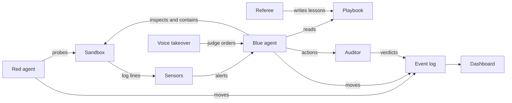

# Crucible

Somewhere right now, an AI agent is being trusted with a company's systems, and nobody can say how good its judgment really is. You can't test it on the real thing, because a wrong call there costs uptime, money, or customer data. Crucible is where you find out first.

Two AI teams play out a containment exercise on a simulated company network. One probes for a way in. The other watches the logs and decides what to shut down. A third, independent model audits every defensive decision against the exact evidence the defender had in front of it. Every move is logged, so any exercise can be replayed, scored, and argued with.

This is Crucible. A crucible is a trial that shows what something is really made of, and that is what this gives AI defenders.

I built it alone during the Meta Global AI Developer Hackathon, with Muse Code and Meta's Muse models.

The first results were wrong. A bug in my own test setup made the defender look smarter than it was. I caught it, threw out the whole campaign, and ran everything again. That habit of measuring, doubting, and measuring again is the point of this project.

With sensor alerts turned on, the defender contained 10 of 10 intrusions in our controlled runs and never lost the secret. With them off, the secret was read in 19 of 20. Below is exactly how we measured that, and what it does not prove.

## Headline results

- With sensor alerts on, Spark blue contained all 20 scripted intrusions and never lost the secret; with them off, the secret was read in 19 of 20 (chain p < 0.0001, noisy p = 0.0001, Fisher exact, computed). Limit: scripted red intrudes every episode by construction, one scenario, 10 episodes per cell.
- Against model red at 10 episodes per arm, the sensors gap was within noise (secret reads 0/10 versus 4/10, p = 0.087). Limit: small sample against a stochastic intruder, so this run concludes nothing about sensors there.
- Frozen-playbook memory cut secret reads on 20 held-out networks against solver red: 7 of 20 with memory versus 18 of 20 without (sensors off, paired exact p = 0.0010), and 11 of 20 versus 17 of 20 (sensors on, p = 0.031). Limit: solver red follows a known path, and Stage 3 sensors fired zero alerts, so this run says nothing about sensors.
- Spark and Spark Open blue each held all 20 scripted episodes with sensors on, though Open reported later (median first report 15 to 17 events versus 1 to 3). Limit: descriptive only at n = 10, with unmatched noisy-red draws across the two runs.

Details, intervals, and limits: `docs/SENSOR_RESULTS.md` and `docs/CAMPAIGN_RESULTS.md`.

## Architecture

- Sandbox of toy hosts on an internal-only Docker network, no published ports.
- One allowlisted action surface (`crucible/tools.py`): agents can only call listed tools against listed hosts.
- Red and blue agents (scripted baselines plus model versions), taking alternating turns through the orchestrator.
- Sensors and asset inventory: blue sees host roles, links, business weights, and deterministic sensor alerts.
- Auditor: a separate model call judges each blue action against the exact log lines blue had seen.
- Referee and playbook: after each exercise the referee merges lessons into a short tactical playbook (scrubbed of credentials, paths, and host names) that blue reads next run.
- Scenario generator: deterministic seeded networks with a proven intrusion path, decoys, dead ends, and noise, split into train and held-out seeds.
- Dashboard: the operations center page with live exercise views, replay, lobby, and results.
- Voice takeover: a judge can type or speak orders that blue executes live, through a command parser plus Muse Voice Transcribe.



## Models used and where

| Where | Model |
|---|---|
| Red team, blue team (main) | Muse Spark (`muse-spark-1.3`) |
| Blue team, open-weights variant | Muse Spark Open (`meta-models/muse-spark-open-1026`) on Baseten |
| Auditor and referee | Muse Wonder (`muse-wonder-1.0`) |
| Voice takeover transcription | Muse Voice Transcribe (`muse-voice-transcribe-1.0`) |
| Dashboard art | Muse Image (`muse-image-1.0`, generated at build time) |
| Dev and bulk runs | Muse Spark contributor (`muse-spark-1.3-contributor`) |

Chat models run through the Meta Model API (`https://api.meta.ai/v1`, OpenAI compatible); the open-weights blue variant runs on Baseten under a separate key. Every model call passes one client wrapper with retries, a disk cache, per-exercise spend logging, and a hard daily spend guard.

## Quickstart (fresh clone)

Prerequisites: Python 3.12 or newer, Docker running, a terminal.

```bash
git clone https://github.com/Lucaszy1/Crucible.git
cd Crucible
python3 -m venv .venv
source .venv/bin/activate
pip install -r requirements.txt
cp .env.example .env
```

Edit `.env`: set `MODEL_API_KEY` (required). Set `BASETEN_API_KEY` only for the open-weights blue variant. `LLM_DAILY_LIMIT_USD` caps estimated model spend per day.

Start the operations center (localhost only, no build step):

```bash
python -m crucible.serve
```

The server binds to localhost only, port 8000 by default (`python -m crucible.serve --port 8123` picks another). Open http://127.0.0.1:8000 in a browser. Use the control bar to run a scripted exercise, run a metered model exercise, or replay a past run.

Run one scripted exercise from the terminal (free, needs Docker):

```bash
python -m crucible.run_exercise --agents scripted --exercise-id demo-1
```

Run a small benchmark (scripted red costs nothing; blue model calls are metered):

```bash
python -m crucible.bench --name try --red chain --sensors on --memory off --episodes-per-cell 2
```

Run the checks without spending anything:

```bash
python -m pytest tests -m "not live" -q
node --test tests/*.mjs
```

Live-marked tests need the range up and can spend money; the `-m "not live"` filter stays on for routine runs.

## Repo layout

```text
crucible/          turn loop, agents, tools, API, scenarios, voice
crucible/agents/   red, blue, auditor, referee, scripted baselines
crucible/scenarios/ generator, simulator, seed sets, Docker stack files
dashboard/         static operations center page (HTML/JS, no build step)
docs/              specs, design notes, runbooks, result analyses
sandbox/           toy host images, compose files, classic scenario
scripts/           probes, art generation, Stage 3 merge and check tools
tests/             Python and node suites plus fixtures
runs/              exercise logs (local only, gitignored except a sample)
playbooks/         live blue playbook (local only, gitignored)
```

`docs/README.md` indexes the design notes and analyses.

## Results

All numbers below come from `docs/CAMPAIGN_RESULTS.md` (20 episodes per arm, classic scenario) and the saved benchmark runs under `runs/bench-*/`. Counts are quoted exactly; p-values marked computed were derived from those counts with exact tests (Fisher for unpaired cells, McNemar for paired Stage 3 seeds).

Validation story first. Our first campaign looked like a win for memory, then analysis showed the result was contaminated: container logs were never cleared between episodes, so blue read stale success lines, quoted them in reports, and red (which could then see blue report text) reused the leaked account names. We threw that campaign out, fixed the design (per-episode log scoping with clean-start checks, and prompts where neither team sees the other team's report text), and reran from scratch. The rerun is the only campaign we report.

Memory versus control (model red and model blue, one scenario, 20 episodes per arm): the memory arm held 16 of 20, control held 10 of 20 (Fisher exact two-sided p = 0.096, not significant at 0.05). Mean blue score was 79.9 versus 49.9 on a bimodal 0-or-100 scale, so the mean restates the win counts. Red probed the exposed admin page in 4 of 20 memory episodes versus 10 of 20 control, and that probe predicted the outcome perfectly; red is blind to blue by construction, so that gap is sampling variation, not something blue caused. That non-finding is specific to its setting (model red, online playbook, one scenario): the gap is within noise, every perfect score came with zero containment against a red that never authenticated, and blue contained 0 of its 4 real intrusions. The frozen-playbook held-out test below is the stronger memory evidence, and it goes the other way.

Sensors with scripted red (`runs/bench-bench1`, classic scenario, Spark blue, memory off, 10 episodes per cell):

| Red | Sensors | Intrusions | Secret reads | Contained |
|---|---|---|---|---|
| chain | on | 10/10 | 0/10 | 10/10 |
| chain | off | 10/10 | 10/10 | 6/10 |
| noisy | on | 10/10 | 0/10 | 10/10 |
| noisy | off | 10/10 | 9/10 | 3/10 |

Secret-read gap, sensors on versus off: chain p < 0.0001, noisy p = 0.0001 (Fisher exact two-sided, computed). Limits, stated plainly: scripted red intrudes in every episode by construction, so this measures containment of a fixed chain, not detection of a varied intruder; one scenario only; 10 episodes per cell.

Stage 3 held-out results (`runs/bench-stage3-heldout`, frozen 8-rule playbook from solver train seeds 1001 to 1009, held-out seeds 9001 to 9020, solver red, Open blue on Baseten, 1 episode per network per cell, 20 paired seeds, audit on the two sensors-on cells):

| Blue | Memory | Intrusions | Secret reads | Contained |
|---|---|---|---|---|
| sensors off | off | 20/20 | 18/20 | 4/20 |
| sensors off | on | 20/20 | 7/20 | 14/20 |
| sensors on | off | 20/20 | 17/20 | 4/20 |
| sensors on | on | 20/20 | 11/20 | 9/20 |

Secret-read Wilson 95 percent: 18/20 (69.9, 97.2), 7/20 (18.1, 56.7), 17/20 (64.0, 94.8), 11/20 (34.2, 74.2). Paired exact (McNemar) two-sided per network: memory beats control on secret reads in all four pairings (sensors off 11-0 discordant, p = 0.0010; sensors on 6-0, p = 0.031; cross pairings 7-0 and 10-0, p = 0.016 and 0.0020), with zero reversals in any pairing. On containment the sensors-off memory gap differs (0-10, p = 0.0020) while the sensors-on memory gap is within noise (0-5, p = 0.0625); both sensors-on versus sensors-off gaps are within noise. Seven networks (9001, 9007, 9009, 9010, 9014, 9017, 9020) lost in all four arms: red signs in on move 2 (easy, hard-intermediate) or 3 (medium) while blue's first move sees only the opening probe, and in 27 of those 28 episodes blue never isolated any host in time.

Limits, stated plainly: solver red replays a known path with seeded noise, so this proves blue contains a known-path intruder on unseen networks, not that it stops an adaptive attacker; 20 networks are one pilot, not coverage; the playbook was learned against the solver's path distribution, where list-before-read always holds; and the Stage 3 sensor comparison is void because sensors fired zero alerts in all 58 sensors-on episodes of the train and held-out benches (the sensor reader polls the classic host list while generated networks use spec hosts, so every lookup missed). Audit covered the two sensors-on cells only (justified 156 of 173 without memory, 207 of 248 with memory). Baseten tokens for the held-out run: 889 calls, 2.06M in / 162k out / 82k reasoning; check the invoice for dollars.

## Open-weights blue

The same blue agent can run on Muse Spark Open (`meta-models/muse-spark-open-1026`) hosted on Baseten instead of Muse Spark on Meta. Red, the auditor, and the referee stay on Meta; only blue's calls move. Set `BASETEN_API_KEY` in `.env` and pass the blue flags:

```bash
python -m crucible.bench --name open-repro --red chain,noisy --sensors on --memory off --episodes-per-cell 10 \
  --blue-model meta-models/muse-spark-open-1026 --blue-base-url https://inference.baseten.co/v1 \
  --blue-api-key-env BASETEN_API_KEY --no-cache
```

Drop the `--blue-*` flags to run the Spark counterpart. Baseten spend shows as $0.00 in our logs by design (token counts only); check the Baseten invoice for real dollars. Full quirks and flag notes: `docs/BASETEN_NOTES.md`.

Spark versus Spark Open (`runs/bench-v2-spark`, `runs/bench-v2-open`; scripted red, sensors on, memory off, audit off, 10 episodes per cell):

| Blue | Red | Intrusions | Secret reads | Contained | Med first report | Meta cost |
|---|---|---|---|---|---|---|
| Spark | chain | 10 | 0 | 10 | 1 | $1.4558 |
| Spark | noisy | 10 | 0 | 10 | 3 | $1.4032 |
| Open | chain | 10 | 0 | 10 | 15 | $0.0000 |
| Open | noisy | 10 | 0 | 10 | 17 | $0.0000 |

Both held every episode. Open reported later but contained at the same median turn; descriptive only, see `docs/SENSOR_RESULTS.md`.

## Demo

- Demo video: TBD (link to be added).
- X post: TBD (link to be added).
- Screenshots: TBD (`docs/media/` shot 1 and shot 2, or one GIF, to be added).

## What was built during the hackathon

From git history: 197 commits, Oct 26 11:34 PT (initial commit) through Oct 27 17:14 PT (latest at time of writing), all inside the event window so far.

Oct 26, 123 commits. Repo skeleton, PRD and build spec, model client with cache and spend guard, Docker sandbox growing from 3 to 4 toy hosts (web, app, db, workstation), allowlisted tools, event schema, orchestrator turn loop and scoring, scripted baselines, model agents with tool calling, batch runner, API backend plus dashboard v1, auditor with live judging and an eval harness, referee with playbook memory and campaigns, then the contamination diagnosis and the per-episode log scoping fix.

Oct 27, 74 commits. Arena and canvas dashboard scenes, removal of the no-effect block tool, asset inventory, deterministic sensor alerts with an on/off flag, intrusion-conditional scoring, the controlled benchmark harness, Baseten open-model blue with effort probes, the scenario generator with simulator proof and train/held-out seeds, the config-driven toy host image with compose renderer and parity harness, frozen playbooks, Stage 3 prep (paired seeds, scrub hardening, runbook, merge and suspicion checks), and voice takeover (command parser, transcribe client with a verified live probe, human blue mode, takeover routes).

TODO: review this timeline against the organizers' answer about the Oct 26 start before submitting, and confirm every listed item counts as event work.

## Responsible design

- Toy hosts only: fixed pretend services with scripted log lines, no real software under test.
- No real malware, no exploit code, no ransomware behavior; the weaknesses are toy misconfigurations such as an open admin page and default credentials.
- Internal Docker network with no published ports; agents reach hosts only through the allowlisted tool surface, enforced in code.
- No real credentials, keys, or data anywhere; API keys live in `.env`, which is gitignored and was never committed.
- A hard daily spend guard stops model calls before cost overruns, and exercises degrade to scripted baselines instead of failing.
