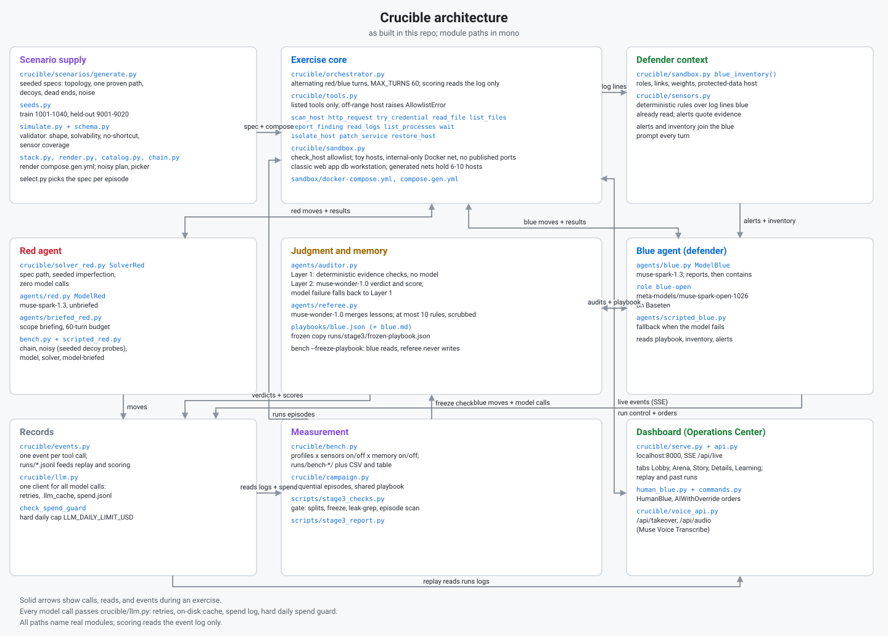

# Crucible: technical writeup

## 1. The problem and why it matters

Teams cannot safely test defenses on live systems. A wrong call on a real network costs uptime, money, or customer data, so defenders get little practice against realistic intrusions. At the same time, AI agents are being trusted with operational systems, and nobody can say how good their judgment really is. AI defenders need honest evaluation: paired scenarios, working sensors, and an independent audit of every move. Crucible runs containment exercises on simulated company networks, logs every move, and scores each exercise so any run can be replayed and argued with.

## 2. What Crucible is

Crucible is a range for containment exercises. Red probes a simulated network. Blue watches logs and sensor alerts and decides what to isolate, patch, restore, or report. An auditor judges every blue action against the exact log lines blue had seen. A referee merges lessons into a playbook that blue reads on later runs. Sensors give deterministic alerts with quoted evidence. Networks are generated from seeds, each with a proven intrusion path, decoys, dead ends, and noise, split into train and held-out sets.

All actions pass through one allowlist in `crucible/tools.py`: listed tools against listed hosts only, on an internal-only network with no published ports. A judge can take the defender seat live by typing or speaking orders; orders parse onto the blue tool surface only, ambiguous orders ask a clarifying question and never guess, and human turns log as assisted blue-side moves so demos never move benchmark stats. Each exercise ends with a debrief: outcome, timeline, detection delay, containment move, strengths, and weaknesses, with every claim citing event ids.

## 3. How Meta models are used

Full diagram in `docs/architecture.svg`: red probes, blue contains, sensors feed alerts, the auditor judges, the referee writes the playbook, and all moves land in one event log.

| Where | Model |
|---|---|
| Red side, blue side (main) | Muse Spark (`muse-spark-1.3`) |
| Blue side, open-weights variant | Muse Spark Open (`meta-models/muse-spark-open-1026`) on Baseten |
| Auditor and referee | Muse Wonder (`muse-wonder-1.0`) |
| Debrief rewrite | Muse Wonder (`muse-wonder-1.0`), must match Layer 1 exactly or fall back unchanged |
| Voice takeover transcription | Muse Voice Transcribe (`muse-voice-transcribe-1.0`) |
| Dashboard art | Muse Image (`muse-image-1.0`, generated at build time) |

Chat models run through the Meta Model API. Only blue moves to Baseten for the open-weights variant; red, auditor, and referee stay on Meta. One client wrapper handles retries, disk cache, per-exercise spend logging, and a hard daily spend guard. Debrief Layer 1 is deterministic code with no model. The optional rewrite only rewords Layer 1, keeping item counts and event-id order, or it falls back unchanged.

## 4. Evaluation design

The pool names train seeds 1001 to 1040 and held-out 9001 to 9020. The frozen playbook was learned on 1001 to 1009: 9 scenarios (3 easy, 3 medium, 3 hard), 2 reps each, 18 episodes, solver red, sensors on, memory on. Held-out uses 9001 to 9020 (7 easy, 7 medium, 6 hard), 1 episode per network per cell, paired by seed.

The frozen playbook has 8 rules, sha256 `76c925e82ddeb30bd592ffe3511bba067aca8dc32db1130185ed8c2422a2c0d8`. A leak check confirms no held-out content (8 rules vs 171 held-out strings, OK). Arms are A sensors-off memory-off, B sensors-on memory-off from the rerun, C sensors-on memory-on from the rerun, plus bonus sensors-off memory-on. B versus C pairs match exactly by scenario and rep with identical red moves, so differences isolate blue. A versus B pairs across benches by scenario, approximate because red re-rolled.

Unbriefed model red intruded in 0 of 18 train episodes, so the main cells use solver red with seeded imperfection. Meta spend was $12.86 on the sensors rerun (auditor calls) and $13.16 on the 20-network briefed run. Baseten bills separately; logs record token counts only, so check the invoice for dollars.

## 5. Results

Briefed red against Spark Open blue on 20 held-out networks: 18 of 20 had an intrusion, all 18 contained, no intrusion on the other 2. Secret reads 0 of 18 (0 of 20 episodes). Median relevant detection delay 7 events (raw 12), median time to contain 22, mean downtime 6.96% over the 18 contained (6.30% over all 20), cost $13.16, Baseten tokens 1,547,043. Fallbacks: 1 of 600 red turns and 11 of 600 blue turns used a safe baseline after replies with no usable tool call, across 9 of 20 episodes. Descriptive only at n=20.

| Arm | n | Intrusions | Secret reads | Contained | Med delay | Med contain | Downtime |
|---|---|---|---|---|---|---|---|
| A sensors-off | 20 | 20/20 | 18/20 | 4/20 | 9 | 14 | 0.75% |
| B sensors-on, rerun | 20 | 20/20 | 0/20 | 20/20 | 15 | 6 | 8.50% |
| C sensors-on plus playbook, rerun | 20 | 20/20 | 0/20 | 20/20 | 11 | 6 | 8.19% |
| Bonus sensors-off plus playbook | 20 | 20/20 | 7/20 | 14/20 | 11 | 12 | 3.88% |

With sensors off, memory differed: secret reads 18 of 20 without memory vs 7 of 20 with memory, contained 4 of 20 vs 14 of 20. With sensors on, both arms contained 20 of 20 with 0 of 20 secret reads, a ceiling effect, so memory is not distinguishable there (B vs C p=1.0 on secret reads, p=0.12 on delay, p=1.0 on downtime, all within noise). The sensors gap differs (A vs B 18-0, p<0.0001), with higher downtime as the cost of containing (0-20, p<0.0001).

What we do not claim: no result shows the playbook generalizes beyond these seeds; 20 networks are one pilot. Within noise is no conclusion, not proof of no effect. Held episodes can reflect red failing on its own. Solver red follows a known path, so this shows containment of a known-path intruder on unseen networks, not of an adaptive intruder. Audit rates cover only rerun B and C. The playbook was learned on train episodes whose sensors were void too, so without sensor input.

The Spark-blue repeat (`runs/bench-stage3-briefed-heldout-blue-spark`) finished on the same 20 held-out networks: intrusions 18/20 Open and 20/20 Spark; both blues contained every intrusion (Open 18/18, Spark 20/20) with no secret reads (Open 0/18, Spark 0/20). Median relevant detection delay 7 events Open vs 1 Spark, median time to contain 22 vs 24, mean downtime 6.30% vs 6.85%, Meta cost $13.16 vs $17.93. Descriptive only at n=20 per arm; briefed red re-rolled between benches, so pairing is approximate and this does not conclude parity.

The sensors-off repeat (`runs/bench-stage3-briefed-heldout-sensors-off`) ran the same 20 held-out networks with sensors off: intrusions 18/20 sensors-on and 19/20 sensors-off; containment 18/18 sensors-on and 4/19 sensors-off; secret reads 0/18 sensors-on and 10/19 sensors-off. Median relevant detection delay 7 events sensors-on vs 15 sensors-off, median time to contain 22 vs 26, mean downtime over contained 6.96% vs 5.12%, Meta cost $13.16 vs $9.20, Baseten tokens 1,547,043 vs 1,148,860. Fallbacks: 1 of 600 red turns and 11 of 600 blue turns sensors-on, 1 of 459 red and 3 of 449 blue sensors-off. Descriptive only at n=20 per arm; briefed red re-rolled between benches, so pairing is approximate and this does not conclude that sensors caused the difference. The plain reading is that blue depends on its sensor feed: with sensors on it contained every intrusion, with sensors off it contained 4 of 19.

## 6. Mistakes we caught and what we changed

The first run sensors-on half is void. Sensors were silently broken on generated networks: the reader polled the classic host list while generated networks use spec hosts, so every lookup missed and no alerts fired. Our gate caught the zero-alert pattern. Two commits fixed it and we reran as `runs/bench-stage3-heldout-sensors`. Void arms stay in the report for the record, never as evidence.

A placeholder key once sailed through startup and ran a whole bench on scripted fallbacks. That run is in `runs/archive` as `bench-stage3-briefed-heldout-401-scriptedred-20261028`, not evidence. Startup now fails loudly: keys under 16 characters or placeholder-like are refused before the range boots, and live runs preflight both keys.

The rerun replayed 14 auditor verdicts from the voided original on byte-identical prompts. No blue, red, or referee response was cached, and outcomes are unaffected. Cache control now runs through bench, single-exercise, and live runs.

Server scoring once used ambient sandbox weights, which lack generated host ids, so old generated runs scored 0 downtime while the live meter read the run layout. Scoring now prefers an explicit override, then the embedded layout, then ambient. Outcome verdicts never depended on weights.

## 7. Limits and what comes next

With sensors on, blue contained every intrusion in all benches: solver cells 20 of 20 twice, briefed Open 18 of 18 and Spark 20 of 20, frontier 9 of 9. With sensors off, it did not: briefed sensors-off contained 4 of 19 intrusions with 10 of 19 secret reads, and solver sensors-off contained 4 of 20 with 18 of 20 secret reads. The frontier tier is built and benchmarked on 10 networks: briefed red against Open blue, 9 of 10 with an intrusion, all 9 contained, 0 of 9 secret reads, median relevant detection delay 7 events, median time to contain 20 events, mean downtime 4.26% over the 9 contained, cost $6.38, Baseten tokens 807,490, descriptive only at n=10. Blue contained every intrusion in the tier, so the tier did not yet find where blue breaks; a stronger or smarter red is the missing piece. The bench accidentally included one classic-network episode; it is excluded from the frontier numbers and reported on its own line. n is small: 20 paired seeds only move large asymmetries to p<0.05, and the frontier run is 10 networks. Hosts are toys with fixed pretend services and scripted log lines; weaknesses are toy misconfigurations like an open admin page and default credentials. This is not a real network. Next is a stronger red, more seeds, and repeated briefed runs past descriptive.

## 8. How to run it

See `README.md`: quickstart, one scripted exercise, one small benchmark, and the offline checks. Live and metered runs need Docker and a `MODEL_API_KEY`, plus `BASETEN_API_KEY` only for the open-weights blue variant.
